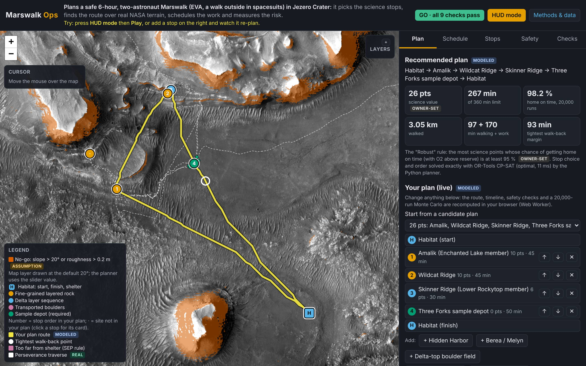

# Marswalk Ops

**A decision-support tool that plans a safe, efficient two-astronaut Marswalk in Jezero Crater. It optimizes the route and the work schedule, measures the risk, and shows the trade-offs.**

NASA Space Apps Challenge 2026 · Challenge: *Interplanetary Survival Guide: Martian Map* · Team: Marswalk Ops (Son Tran)

**Live app: https://sonctran.github.io/nasa/** (no login; works in Chrome and Edge, desktop or tablet) · Repo: https://github.com/sonctran/nasa

> Status: **Phase 4 (validate + deploy) done.** The app is public on GitHub Pages and redeploys on every push. An independent review checked the numbers, labels and credits; see `PROGRESS.md`.



**Results (modeled):** the recommended plan visits 3 real Perseverance sample sites plus the Three Forks depot: 26 science points, 3.05 km, 267 of 360 min. It gets home on time in **98.2 %** of 20,000 Monte Carlo runs, and all 9 go/no-go checks pass. A 30-point plan sits right on the 95 % safety bar (94.96 % to 95.9 %, depending on the walking model). Stop order is solved to proven optimality with OR-Tools CP-SAT.

## Run it locally (Windows PowerShell)

Needs **Python 3.12, 3.13 or 3.14** (64-bit). Python 3.11 will not work (see `DECISIONS.md`).

```powershell
py -3.12 -m venv .venv
.\.venv\Scripts\python.exe -m pip install -r requirements.txt
.\.venv\Scripts\python.exe -m pytest
```

(Change `3.12` to the version you have. Run `py --list` to see installed versions.)

Rebuild all the map data from NASA/USGS sources (about 3 minutes, needs internet, about 55 MB in `data\raw`):

```powershell
.\.venv\Scripts\python.exe -m pipeline.run_all
```

Preview images of every layer are saved in `data\processed\previews\`.

Build the plan, the results file for the app (`site\assets\data\plan.json`) and the result pictures (about 15 s):

```powershell
.\.venv\Scripts\python.exe -m planner.run_plan
```

## Open the web app locally

```powershell
.\.venv\Scripts\python.exe -m http.server 8000 --directory site
```

Then open http://localhost:8000 in Chrome or Edge. (Double-clicking `site\index.html` will not work: browsers block loading data files from `file://`.)

Click-through test with screenshots (saved in `docs\screenshots\`, plus `report.json` with any console errors):

```powershell
.\.venv\Scripts\python.exe -m playwright install chromium
.\.venv\Scripts\python.exe scripts\screenshot.py
```

## Data credits

Full list with exact URLs: `docs/DATA_SOURCES.md`.
- HiRISE DTM and orthomosaic: Fergason et al. 2020, USGS Astrogeology (doi:10.5066/P9REJ9JN, doi:10.5066/P9QJDP48). HiRISE data: NASA/JPL-Caltech/University of Arizona.
- CTX DTM (cross-check): USGS (doi:10.5066/P906QQT8). CTX data: NASA/JPL-Caltech/MSSS.
- THEMIS IR: NASA/JPL-Caltech/Arizona State University, via NASA Mars Trek.
- Perseverance traverse, waypoints and raw images: NASA/JPL-Caltech (Mastcam-Z: NASA/JPL-Caltech/ASU).
- Three Forks depot data: NASA PDS Geosciences Node.
- Solar particle events: NASA CCMC DONKI.
- Map library: Leaflet 1.9.4 (BSD-2-Clause), vendored in `site/vendor/leaflet/`.
- Science stop sites: NASA PDS Geosciences Node, Mars 2020 Initial Reports (sample dossier).
- Human-factors and suit numbers: NASA xEVA ConOps (EVA-EXP-0042), NASA BVAD (TP-2015-218570 Rev 2), Waligora & Horrigan 1975 (Apollo metabolic data), Apollo EMU Operations Handbook. Radiation: NASA PIA17600 and NASA Science (May 2024 storm). Full list: `docs/DATA_SOURCES.md`.

## Use of AI

This project uses AI tools, and says so openly:
- **Ideation:** Claude (Anthropic) suggested concept upgrades. Son Tran chose which to keep.
- **Code generation:** most code (data pipeline, planner and web app) is written with Claude Code, then reviewed and tested.
- **Research and writing:** Claude Code helped find and check data sources and draft docs.

No AI-generated images are used: every picture is real NASA/USGS imagery or a real screenshot of the app. Any AI-generated image added later must carry a visible "AI-generated" watermark. The app prefers real NASA imagery and real screenshots.

## License

MIT. See `LICENSE`.
