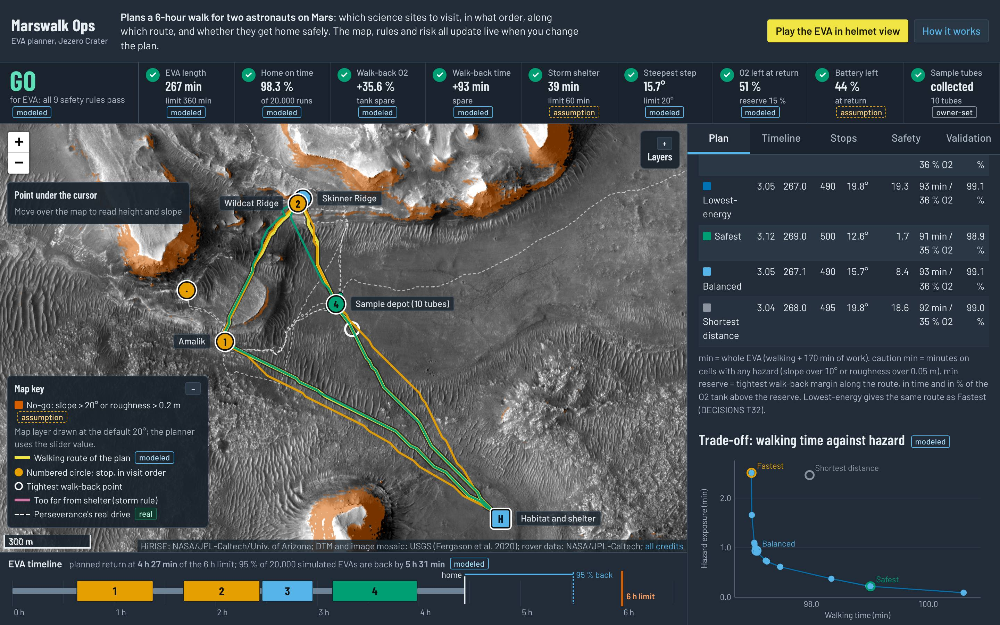
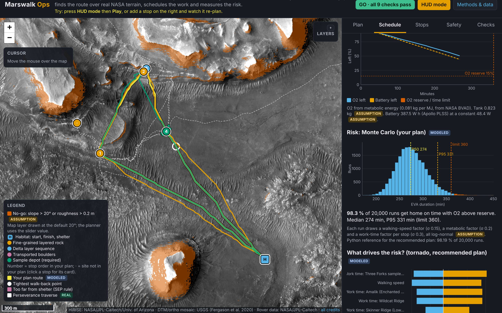
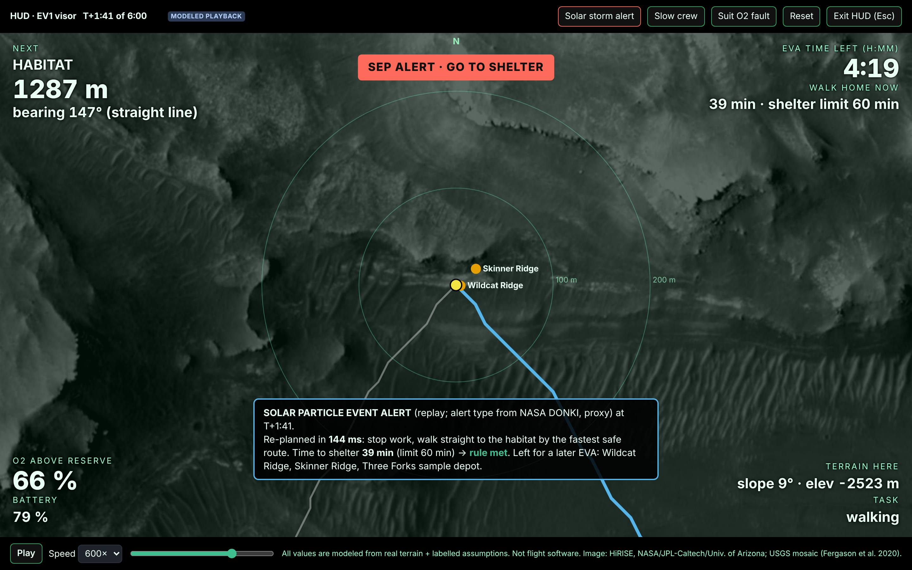

# Marswalk Ops

**Plan a six-hour, two-astronaut walk on Mars, and know the odds of getting home on time.**
A decision-support tool for Jezero Crater built on real NASA terrain data. It optimizes the route and the work schedule, measures the risk, and shows the trade-offs.

NASA Space Apps Challenge 2026 · Challenge: *Interplanetary Survival Guide: Martian Map* · Team: Marswalk Ops (Son Tran)

**Live app: https://sonctran.github.io/nasa/** (no login; Chrome or Edge, desktop or tablet)
Slides (7): https://sonctran.github.io/nasa/demo_slides.pdf · Methods and data: https://sonctran.github.io/nasa/methods.html


## The problem

The first people on Mars will work outside on foot, in suits, with a fixed oxygen supply and a hard time limit. A map shows the ground. A plan has to answer four questions:

1. Where is it safe to walk?
2. Which way should we go?
3. Which science stops fit, and in what order?
4. How likely are we to get home on time if things run slow?

**The mission in this build:** two astronauts leave a habitat on the floor of Jezero Crater, pick up the 10 sample tubes Perseverance left at the Three Forks depot, visit real delta-front science sites, and walk home inside 6 hours.

## The method (industrial engineering, applied to a Marswalk)

| Question | Method | Result for the recommended plan (modeled) |
|---|---|---|
| Where is it safe? | Slope and roughness from the 1 m HiRISE elevation model on a 10 m grid; no-go above 20° (NASA lunar suit limit, proxy) | 5.1 % of the area is no-go; the route's steepest cell is 15.7° |
| Which way? | A* on a 16-direction grid; step cost = time + energy + hazard from a human-factors walking model | 3.05 km, 97 min of walking, 8.4 min on caution terrain |
| Which stops, what order? | Prize-collecting orienteering problem, solved exactly with Google OR-Tools CP-SAT | 26 science points; proven optimal in 11 ms |
| Will we get home? | 20,000-run Monte Carlo; the plan must succeed in at least 95 % of runs | 98.2 % of runs; planned 267 of 360 min, 95th percentile 331 min |
| What if the day changes? | Walk-back rule at every 10 m (Apollo), solar-storm shelter rule, live re-plan in the browser | Tightest margin 93 min and 36 % of the oxygen tank; never more than 39 min from shelter (limit 60) |

## Results (all modeled)

**The trade-off the tool exists to show: more science costs margin.**

| Plan | Science points | Planned length | Home on time, oxygen OK |
|---|---|---|---|
| Short | 20 | 230 min | 99.8 % |
| **Recommended ("Robust")** | **26** | **267 min** | **98.2 %** |
| One more stop | 30 | 286 min | 94.96 % (just under the 95 % bar; a second walking model says 95.9 %) |
| Maximum science | 36 | 317 min | 79.7 % |

- **Task time, not walking, drives the risk.** Work at the stops is 170 of the 267 planned minutes. The largest single driver is work time at the depot (39 min swing).
- **A small detour buys a lot of safety.** The safest route costs 2.0 more minutes than the fastest and cuts time on steep or rough ground from 19.3 to 1.7 minutes.
- **All 9 go/no-go checks pass** for the recommended plan. Add one more stop in the app and the header turns to NO-GO.
- **Fast enough to play with.** First route on screen in under a second. A full re-plan in the browser (routes, safety checks and a 20,000-run simulation) takes about a third of a second.

| Trade-offs and route options | Risk: Monte Carlo and what drives it | Helmet view with live re-plan |
|---|---|---|
|  |  |  |

## How we know it holds up

- **172 automated tests pass.** A* gives exactly the same cost as Dijkstra. The browser planner matches the Python planner cell for cell. CP-SAT matches brute force on 25 random cases.
- **Apollo 14.** With lunar gravity, the walking model predicts the uphill walking legs at 2.11 km/h against 2.13 km/h measured.
- **Real rover drives.** On Perseverance's crater-floor drive, 53 % of our planned path is within 25 m of the rover's real path, against 38 % for a straight line. On the delta-top climb the result was inconclusive (36 % against 30 %). A rover is not a human; this is supporting evidence only.
- **Georeferencing.** Our elevation grid matches the rover's recorded elevation at 181 waypoints to 0.06 m RMS.

## Limits (read these)

- Walking and suit numbers are lunar, Earth or design values applied to Mars. NASA reports higher metabolic rates in Mars gravity, so walking cost is probably underestimated.
- Work times, the 60-minute shelter limit, the 15 % oxygen reserve and the simulation spreads are assumptions. All are listed in `docs/ASSUMPTIONS.md`.
- The 30-point plan sits right on the 95 % line. Treat 26 against 30 points as a close call.
- Radiation is a Gale-crater proxy. Solar events are near-Earth records. The 10 m grid cannot see rocks smaller than a few metres.
- Every modeled, assumed or proxy value is labelled in the app. This is a planning study, not flight software.

## What is in the repository

| Folder | What |
|---|---|
| `pipeline/` | Downloads and crops the NASA/USGS data, derives slope, roughness and no-go, exports web layers |
| `planner/` | Cost model, A*, OR-Tools stop scheduling, Monte Carlo, safety rules, validation |
| `site/` | The web app: static files, no build step. `js/engine.js` is the planner ported to the browser |
| `tests/` | 172 pytest tests, including a Python-against-browser parity test |
| `docs/` | `METHODS.md`, `ASSUMPTIONS.md` (every parameter), `DATA_SOURCES.md` (every URL), screenshots |
| `submission/` | Project page text, 7-slide deck, video script, resume bullets, submit checklist |
| `config/` | `params.yaml`: every model parameter with its source or the word "assumption" |

`SPEC.md` is the build spec, `DECISIONS.md` the decision log, `PROGRESS.md` the measured results of each phase.

## Run it locally (Windows PowerShell)

Needs **Python 3.12, 3.13 or 3.14** (64-bit). Python 3.11 will not work (see `DECISIONS.md`).

```powershell
py -3.12 -m venv .venv
.\.venv\Scripts\python.exe -m pip install -r requirements.txt
.\.venv\Scripts\python.exe -m pytest
```

(Change `3.12` to the version you have. Run `py --list` to see installed versions.)

Rebuild all the map data from NASA/USGS sources (about 3 minutes, needs internet, about 55 MB in `data\raw`):

```powershell
.\.venv\Scripts\python.exe -m pipeline.run_all
```

Preview images of every layer are saved in `data\processed\previews\`.

Build the plan, the results file for the app (`site\assets\data\plan.json`) and the result pictures (about 15 s):

```powershell
.\.venv\Scripts\python.exe -m planner.run_plan
```

## Open the web app locally

```powershell
.\.venv\Scripts\python.exe -m http.server 8000 --directory site
```

Then open http://localhost:8000 in Chrome or Edge. (Double-clicking `site\index.html` will not work: browsers block loading data files from `file://`.)

Click-through test with screenshots (saved in `docs\screenshots\`, plus `report.json` with any console errors):

```powershell
.\.venv\Scripts\python.exe -m playwright install chromium
.\.venv\Scripts\python.exe scripts\screenshot.py
```

Rebuild the slide deck from the current results and screenshots:

```powershell
.\.venv\Scripts\python.exe scripts\build_deck.py
```

## Data credits

Full list with exact URLs: `docs/DATA_SOURCES.md`.
- HiRISE DTM and orthomosaic: Fergason et al. 2020, USGS Astrogeology (doi:10.5066/P9REJ9JN, doi:10.5066/P9QJDP48). HiRISE data: NASA/JPL-Caltech/University of Arizona.
- CTX DTM (cross-check): USGS (doi:10.5066/P906QQT8). CTX data: NASA/JPL-Caltech/MSSS.
- THEMIS IR: NASA/JPL-Caltech/Arizona State University, via NASA Mars Trek.
- Perseverance traverse, waypoints and raw images: NASA/JPL-Caltech (Mastcam-Z: NASA/JPL-Caltech/ASU).
- Three Forks depot data: NASA PDS Geosciences Node.
- Solar particle events: NASA CCMC DONKI.
- Map library: Leaflet 1.9.4 (BSD-2-Clause), vendored in `site/vendor/leaflet/`.
- Science stop sites: NASA PDS Geosciences Node, Mars 2020 Initial Reports (sample dossier).
- Human-factors and suit numbers: NASA xEVA ConOps (EVA-EXP-0042), NASA BVAD (TP-2015-218570 Rev 2), Waligora & Horrigan 1975 (Apollo metabolic data), Apollo EMU Operations Handbook, Minetti et al. 2002, Tobler 1993. Radiation: NASA PIA17600 and NASA Science (May 2024 storm). Full list: `docs/DATA_SOURCES.md`.

No NASA logos, flags or mission insignia are used anywhere in this project.

## Use of AI

This project uses AI tools, and says so openly:
- **Ideation:** Claude (Anthropic) suggested concept upgrades. Son Tran chose which to keep.
- **Code generation:** most code (data pipeline, planner and web app) is written with Claude Code, then reviewed and tested.
- **Research and writing:** Claude Code helped find and check data sources and drafted the docs, the slides and the submission text.

No AI-generated images are used: every picture is real NASA/USGS imagery or a real screenshot of the app. Any AI-generated image added later must carry a visible "AI-generated" watermark.

## License

MIT. See `LICENSE`.
